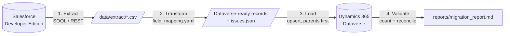

# Salesforce → Dynamics 365 Migration


An end-to-end CRM data migration from **Salesforce** to **Microsoft Dynamics 365 Sales**. It covers Accounts, Contacts, Opportunities and Leads, with their relationships, built as a repeatable Python ETL pipeline. Everything runs on free accounts: a Salesforce Developer Edition and a Dynamics 365 trial.

## What this project demonstrates

- **CRM data modelling:** mapping Salesforce objects and fields to Dataverse tables and columns, including lookups and required fields
- **API integration:** Salesforce REST API (SOQL) and the Dataverse Web API (OData v4), signing in through Microsoft Entra ID (MSAL)
- **Safe re-runs:** upserts keyed on the original Salesforce Id, so a load can be repeated without creating duplicates
- **Data quality:** orphaned records, bad numbers and dates, and missing required fields are flagged without stopping the run
- **Validation:** an automated reconciliation report compares Salesforce rows with records found in Dynamics
- **Engineering practice:** unit tests, linting and an end-to-end dry run in GitHub Actions; secrets and customer data kept out of git

## How it works



| Order | Salesforce | Dynamics 365 | Relationship |
|---|---|---|---|
| 1 | Account | account | parent |
| 2 | Contact | contact | → account (`parentcustomerid`) |
| 3 | Opportunity | opportunity | → account (`parentaccountid`) |
| 4 | Lead | lead | none |

The full mapping and the design decisions behind it are in [docs/04-map-fields.md](docs/04-map-fields.md).

## Try it in 2 minutes (no accounts needed)

```bash
git clone https://github.com/Carol-Purity/Salesforce-Dynamics-Migration.git
cd Salesforce-Dynamics-Migration
python -m venv .venv
source .venv/bin/activate          # Windows: .venv\Scripts\activate
pip install -r requirements.txt
python -m sfdm migrate --dry-run
```

This runs the whole pipeline on the fictional data in `sample_data/` against a simulated Dynamics, and writes [`reports/dry_run_report.md`](reports/dry_run_report.md).

## Step-by-step guide

| Step | What you do | Time |
|---|---|---|
| 0 | **Before you start:** install [Python 3.10+](https://www.python.org/downloads/) and [Git](https://git-scm.com/downloads), clone this repo, run the 2-minute dry run above | 15 min |
| 1 | [Set up the Salesforce source org](docs/01-set-up-salesforce.md) | 20 min |
| 2 | [Set up the Dynamics 365 trial](docs/02-set-up-dynamics.md) | 30 min |
| 3 | [Export data from Salesforce](docs/03-export-from-salesforce.md) | 15 min |
| 4 | [Map the fields and do a dry run](docs/04-map-fields.md) | 20 min |
| 5 | [Load the data into Dynamics](docs/05-load-into-dynamics.md) | 10 min |
| 6 | [Validate the result and showcase it](docs/06-validate-and-showcase.md) | 30 min |

## Results

<!-- After Step 6, replace this table with the one from reports/migration_report.md -->

| Object | Salesforce rows | In Dynamics | Status |
|---|---:|---:|---|
| Account | _tbd_ | _tbd_ | ⏳ |
| Contact | _tbd_ | _tbd_ | ⏳ |
| Opportunity | _tbd_ | _tbd_ | ⏳ |
| Lead | _tbd_ | _tbd_ | ⏳ |

<!-- Uncomment once the screenshots exist:
| Salesforce (before) | Dynamics 365 (after) |
|---|---|
|  |  |
-->

## Project structure

```
├── sfdm/                     # the migration tool
│   ├── extract.py            # Salesforce → CSV
│   ├── transform.py          # CSV → Dataverse records + data-quality issues
│   ├── dataverse.py          # Dataverse Web API client (+ dry-run client)
│   ├── load.py               # upsert, parents first, lookup resolution
│   └── report.py             # reconciliation + Markdown report
├── mapping/field_mapping.yaml
├── sample_data/              # fictional Salesforce export used by tests and CI
├── tests/
├── docs/                     # step-by-step guide + screenshots
└── .github/workflows/ci.yml
```

## Scope and limitations

Out of scope for v1, with the reasons in [docs/04-map-fields.md](docs/04-map-fields.md):

- picklist value mapping
- closing Won/Lost opportunities
- record owners
- activities and attachments
- automation (Flows/Apex are rebuilt in Power Automate, not copied)

## Author

**Carol Purity**. [GitHub](https://github.com/Carol-Purity)

Licensed under [MIT](LICENSE).
